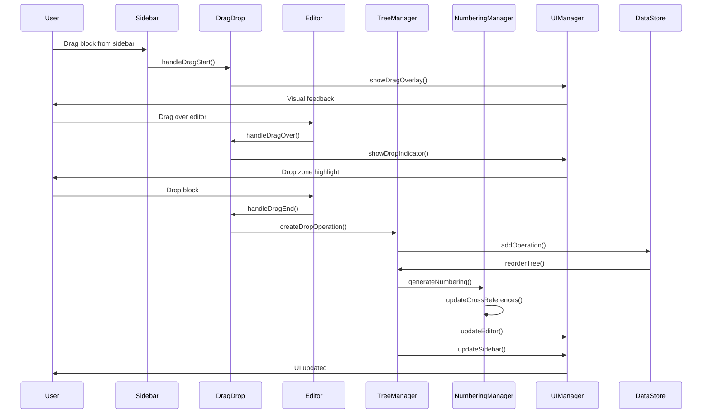
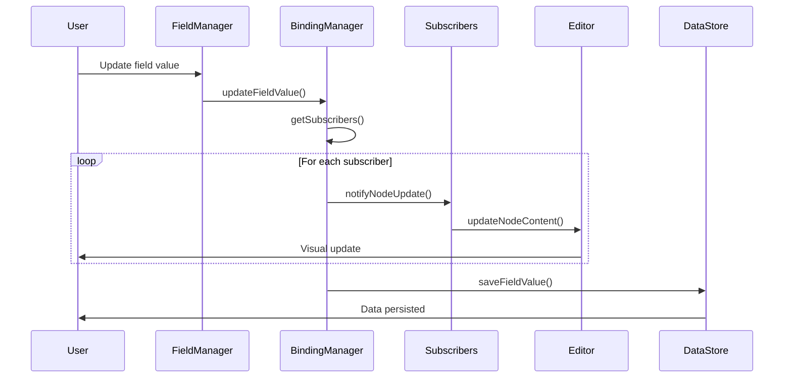
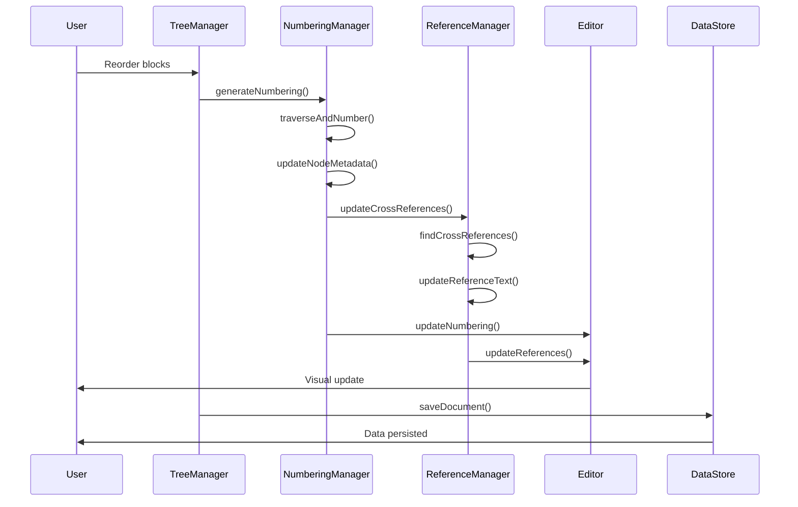
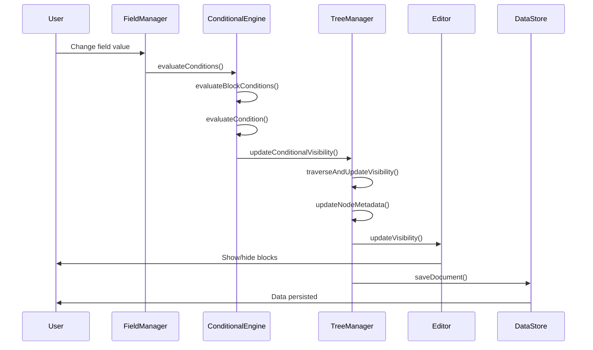
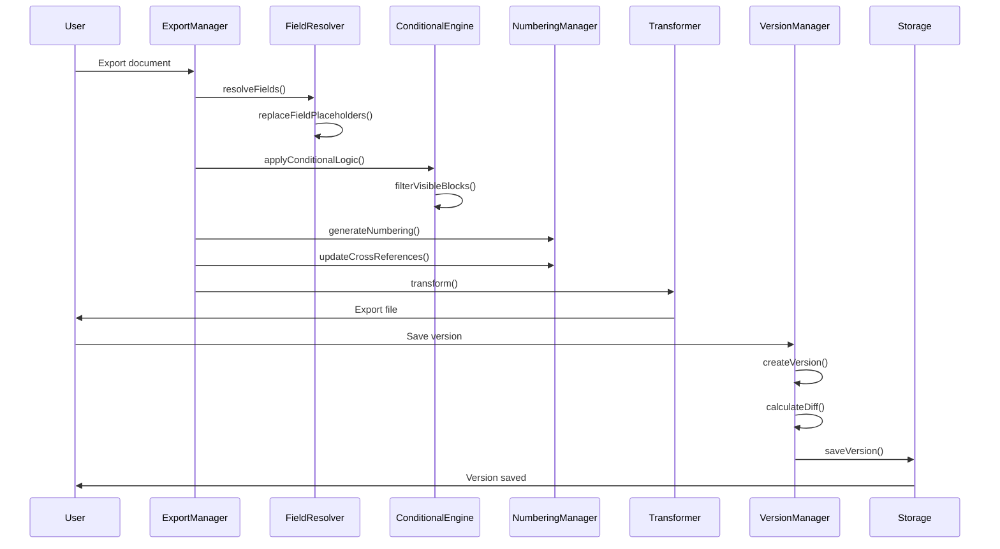
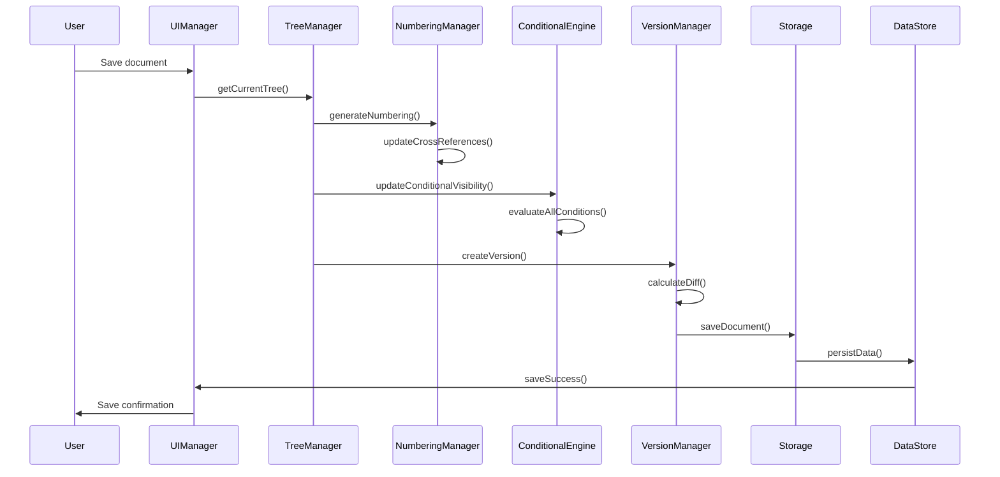
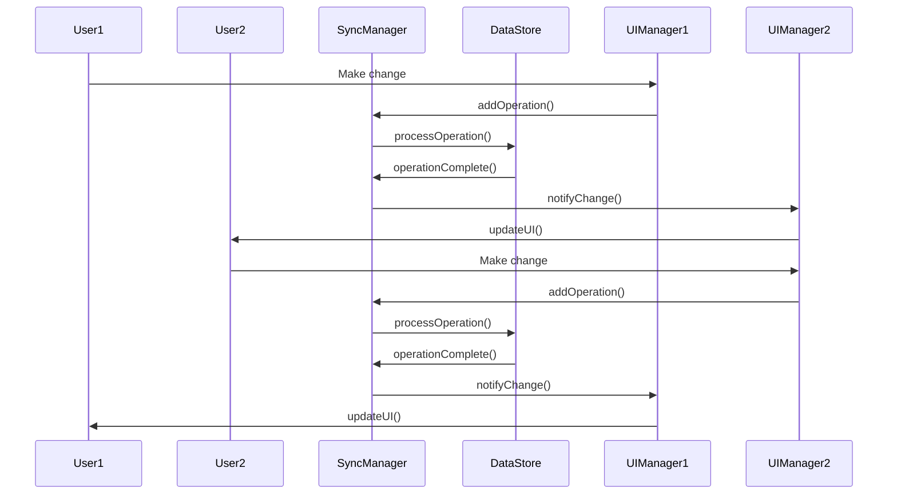
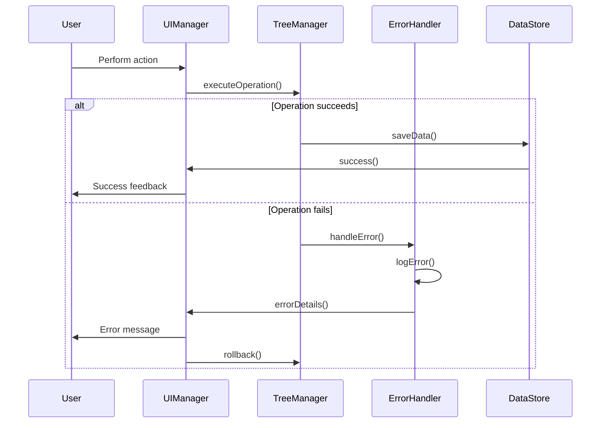
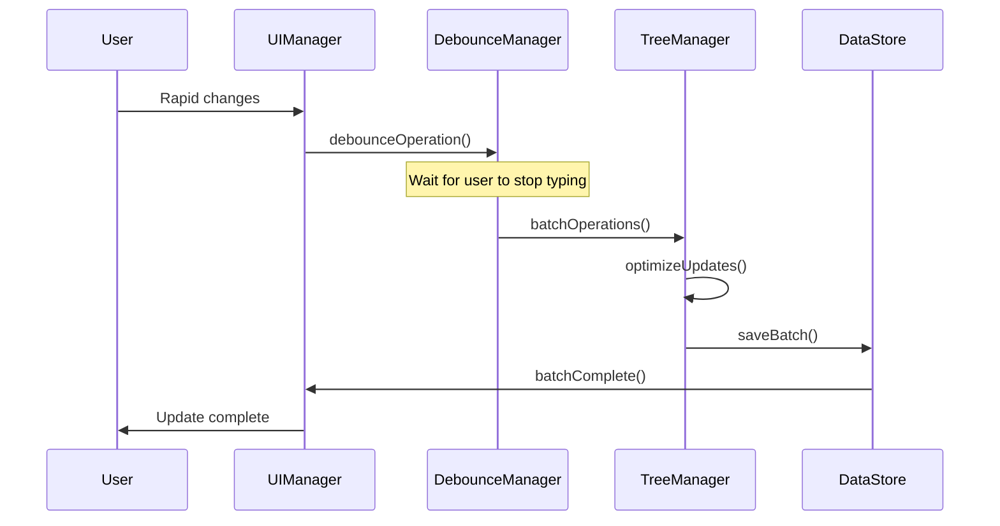

# Sequence Diagram - Template Editor Data Flow

## 🔄 **1. Drag & Drop Pipeline Sequence**

## 🔗 **2. Field Binding & Sync Sequence**

## 🔢 **3. Auto Numbering & Cross-Reference Sequence**

## 🔀 **4. Conditional Logic Sequence**

## 📤 **5. Export & Versioning Sequence**

## 🔄 **6. Complete Document Save Sequence**

## 🎯 **7. Real-time Sync Sequence**

## 🔧 **8. Error Handling Sequence**

## 📊 **9. Performance Optimization Sequence**

## 🎯 **Key Algorithm Insights:**

### **1. Event-Driven Architecture**
- Tất cả thay đổi đều thông qua event pipeline
- Debouncing cho performance optimization
- Batch operations để giảm overhead

### **2. Single Source of Truth**
- DataStore là nguồn dữ liệu duy nhất
- Tất cả UI components subscribe đến changes
- Real-time sync giữa các components

### **3. Optimistic Updates**
- UI update ngay lập tức cho responsiveness
- Background sync với server
- Rollback mechanism cho error handling

### **4. Caching Strategy**
- Numbering cache để tránh recalculate
- Field value cache cho performance
- Reference cache cho cross-references

### **5. Error Recovery**
- Automatic retry cho failed operations
- Graceful degradation khi network issues
- User-friendly error messages

Thuật toán này đảm bảo hệ thống hoạt động mượt mà, responsive và reliable trong mọi tình huống.